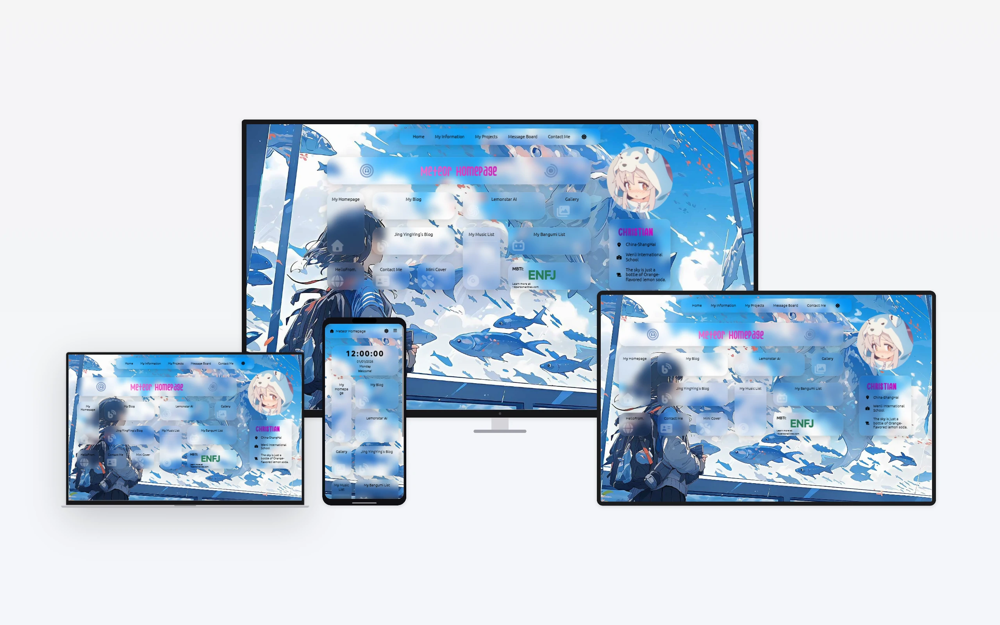
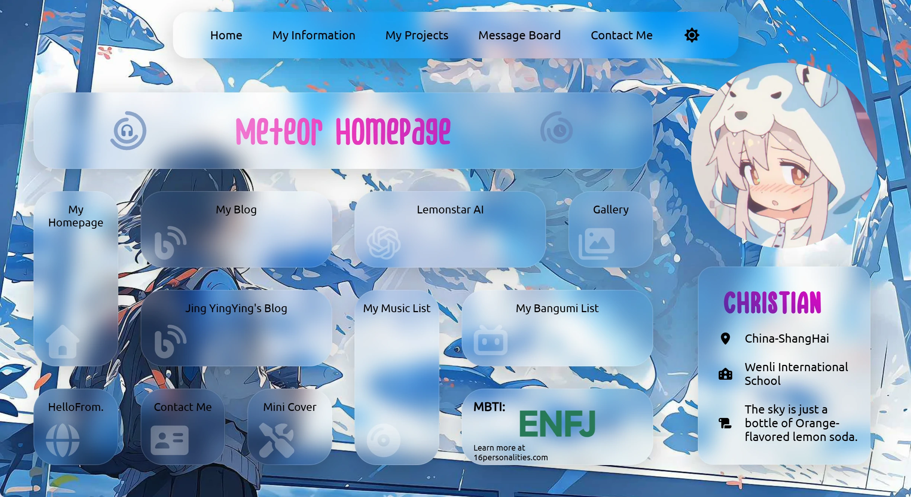

<div align="center">
	<h1>Meteor Homepage</h1>
	<p>A creative, customizable personal homepage.</p>
	<p>English / <a href="README_cn.md" >简体中文</a></p>
	<p align="center">
  
  
  
  
</p>

<p align="center">
  
  
  
</p>
</div>

# Preview





# Features

- Responsive Webpage

- Unique Status Circle

- Music Player

- Glassmorphism Effect

- Bento Box Layout

- Multi-page Personal Homepage

- Vercel One-click Deployment Support

# User Guide

## Guide to Customise

### index.html

#### Website title

In the `<head>` part of every HTML file:

[Example](index.html#L35)

```html
<title>Yangle's Homepage | 20100807.xyz</title>
```

#### Website Icon

In the `<head>` part of every HTML file:

[Example](index.html#L38)

```html
<link rel="icon" href="/static/img/favicon.webp">
```

#### Profile Photo

In the `<body>` part of every HTML file:

[Example](index.html#L87)

```html
<header>
	
</header>
```

### JavaScript.js 

Recommended customisation:

[Line 19 ~ 31](static/js/JavaScript.js#L19-L31)

Optional:

+ [Line 199](static/js/JavaScript.js#L199) (Default Volume Tier)
+ [Lines 440 to 460](static/js/JavaScript.js#L440-L460) (The Phases and emojis corresponding to the Weather code)
+ [Lines 534 to 546](static/js/JavaScript.js#L534-L546) (Greetings)
+ [Lines 576 to 623](static/js/JavaScript.js#L576-L623) (Positioning and weather service)

### css.css 

Recommended customisation:

[Lines 21 to 41](static/css/css.css#L21-L41) (Including background image)

Optional:

+ [Lines 43 to 66](static/css/css.css#L43-L66) (Fonts)
+ [Lines 522 to 570](static/css/css.css#L522-L570) (Colors of special words)
+ [Lines 1318 to 1337](static/css/css.css#L1318-L1337) (Glassmorphism Effect)
+ [Lines 1419 to 1519](static/css/css.css#L1419-L1519) (Basic Icon animation settings)

### config.js 

Optional:

[The Whole File](static/js/config.js) (Cover art, author and music source URL)

(Line numbers could change; please refer to the actual file.)

## Guide to Bento Box Layout

The project's homepage uses Bento Box Layout. The homepage use a 6\*3 grid, with induvidual cards supporting size up to 6\*3.

To apply size to cards, set the class name on the [cards](index.html#L220-L310) in index.html:

```html
class="span-1x1"
```

The first number is columns, and the second one is rows. The largest supported card size is 6\*3.

e.g:
```html
<div class="span-2x1">
Your card contents
</div>
```

Be sure to check the layout for overflow.

## Guide to Visual Effects

### Guide to icon animations

This project uses 12 free Icon animations provided by Font Awesome. They take effect when the mouse hovers over the card.

To apply the animation to Icons, add the class name to the [cards](index.html#L220-L310) in index.html:

```html
<div class="span-2x1 fade">
Your card contents
</div>
```

The usable animations are:

- spin

- fade

- shake

- bounce

- flip

- flip-360

- flip-360-vertical

- beat

- jello

- beat-fade

- buzz

- float

### Guide to Icons 

This project uses Icons from the [Font Awesome](https://fontawesome.com/) Icon library. Since it is already imported, you can use it directly.

Usage:
``` html
<i class="fa-<icon class> fa-<icon name>"></i>
```

e.g:

```html
<i class="fa-solid fa-blog"></i>
```

## Explanation of Weather Service

This project uses [Open-Meteo](https://open-meteo.com) as the source of weather data and uses the user's IP address to determine the approximate position. IP-based geolocation may be inaccurate, so the displayed weather may differ from your actual location; Weather information is provided for reference only.

The relevant code is at [Line 576~618](static/js/JavaScript.js#L576-L618) of `JavaScript.js`.

## Guide to Deployment

### 1. Vercel One-click Deployment

1. Click the button below to deploy:

[](https://vercel.com/new/clone?repository-url=https://github.com/yangle-q/Meteor-Homepage)

2. Open the repository cloned to your GitHub and customise files and layouts.

3. After saving, redeployment will be triggered automatically.

4. Bind it to your domain.

### 2. Cloudflare Pages

1. Fork this repository to your account.

2. Customise files and layouts.

3. Open [Cloudflare Dashboard](https://dash.cloudflare.com/)

4. Navigate to Workers & Pages → Create application → Pages

5. Bind to your GitHub account and choose the repository you forked 

6. Check and deploy the project.

7. Bind it to your domain.

### 3. Self-hosted Deployment

1. Clone this project to your computer:
    ```bash
	git clone https://github.com/yangle-q/Meteor-Homepage.git
	cd Meteor-Homepage
	```

2. Modify the Files and launch the Python preview server:
    ```python
	python -m http.server 8000
	```

3. Upload to the server and bind it to your domain.

# External Resources

Icon library: [Font Awesome](https://fontawesome.com/)

# Online Preview

[Visit Meteor Homepage](https://20100807.xyz)

# Repository Structure

```md
Meteor-Homepage/
├── index.html
├── contact/
├── info/
├── message/
├── projects/
├── static/
│   ├── css/
│   ├── js/
│   └── img/
├── README.md
├── .gitignore
└── LICENSE
```

# License

Meteor Homepage is licensed under the [GNU Affero General Public License v3.0 (AGPL-3.0)](LICENSE).

You are free to use, modify, distribute, and deploy this project, including for commercial purposes, provided that you comply with the license terms.

Modified versions and derivative works must remain under the AGPL-3.0 license when distributed. If you modify the project and make it available for remote network interaction, you must also provide users with access to the corresponding source code, as required by Section 13 of the license.