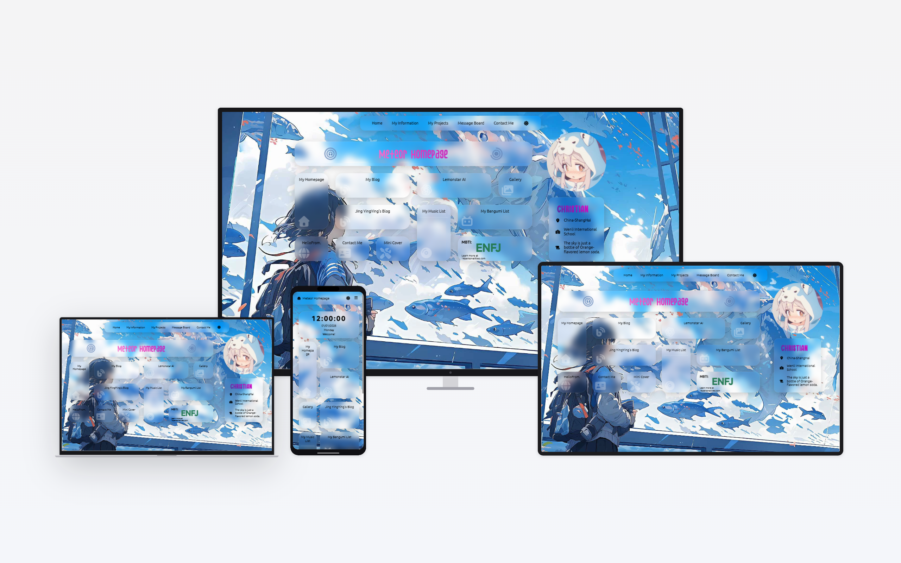
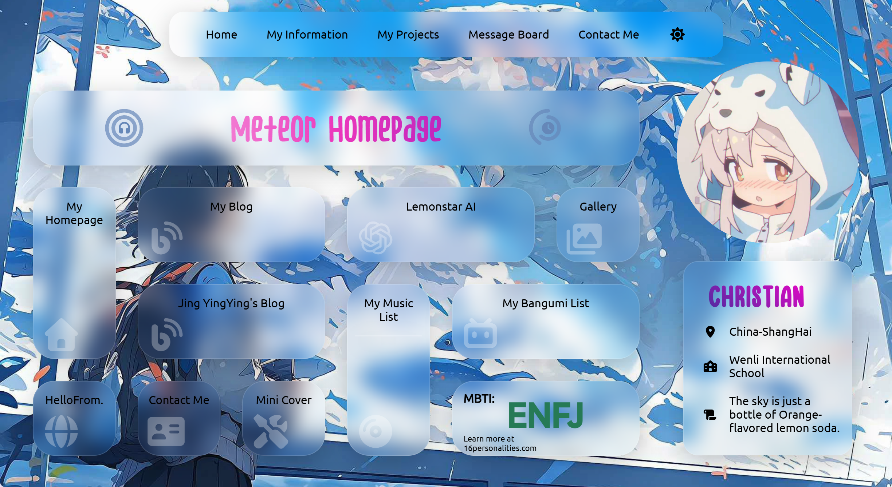
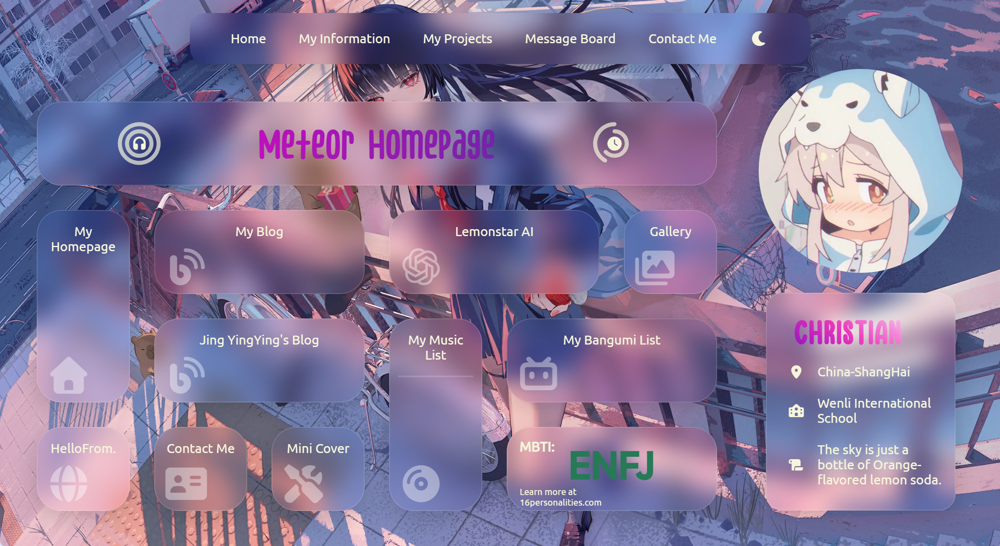

<div align="center">
	<h1>Meteor Homepage</h1>
	<p>A creative, customizable personal homepage.</p>
	<p>一款创意型的，可自定义的个人主页项目</p>
	<p><a href="README.md" >English</a> / 简体中文</p>
	<p align="center">
  
  
  
  
</p>

<p align="center">
  
  
  
</p>
</div>

# 预览






# 功能特点

- 响应式布局

- 独特状态圈设计

- 原生音乐播放器

- 毛玻璃视觉效果

- Bento Box 网页布局

- 多页面个人主页

- 支持 Vercel 一键部署

# 使用指南

## 本地文件修改指南

### index.html

#### 网站title

每个html文件的head中：

[示例](index.html#L35)

```html
<title>Yangle's Homepage | 20100807.xyz</title>
```

#### 网站图标

每个html文件的head中：

[示例](index.html#L38)

```html
<link rel="icon" href="/static/img/favicon.webp">
```

#### 个人头像

每个html文件的body中：

[示例](index.html#L87)

```html
<header>
	
</header>
```
### JavaScript.js 

建议修改：[19 ~ 31 行](static/js/JavaScript.js#L19-L31)

可选修改：
+ [199 行](static/js/JavaScript.js#L199)（默认音量档位）
+ [440 行 至 460 行](static/js/JavaScript.js#L440-L460)（天气代码对应的文字和图标）
+ [534 行 至 546 行](static/js/JavaScript.js#L534-L546)（问候语）
+ [576 行 至 623 行](static/js/JavaScript.js#L576-L623)（天气定位和服务依赖逻辑）

### css.css 

建议修改：
[21 ~ 41 行](static/css/css.css#L21-L41)（包括背景图像）

可选修改：
+ [43 ~ 66 行](static/css/css.css#L43-L66)（字体）
+ [522 ~ 570 行](static/css/css.css#L522-L570)（特别文字颜色）
+ [1312 ~ 1331 行](static/css/css.css#L1312-L1331)（玻璃效果）
+ [1413 ~ 1513 行](static/css/css.css#L1413-L1513)（图标动画基础设定）

### config.js 

可选修改：

[整个文件](static/js/config.js)（音乐封面，歌手及播放地址）

（行号有可能变化，请以实际为准）

## 便当盒布局指南

本项目首页采用便当盒布局（Bento Box Layout），可供使用的空间为6\*3格，支持的最大单格为6\*3格。

要应用格子大小到卡片，在[卡片](index.html#L220-L310)的类名中添加：
```html
class="span-1x1"
```
第一个数是行，第二个数是列。最大支持`span-6x3`。

示例：
```html
<div class="span-2x1">
你的格子内容
</div>
```

请注意排版，避免格子超出可用范围。

## 视觉效果指南

### 图标动画指南

本项目使用font awesome提供的12个免费动画，均为鼠标悬浮时生效。

要应用动画大小到图标，在[卡片](index.html#L220-L310)的类名中添加：
```html
class="fade"
```

可用动画有：

- spin（旋转）

- fade（闪烁）

- shake（晃动）

- bounce（弹跳）

- flip（翻转）

- flip-360（360度翻转）

- flip-360-vertical（360度垂直翻转）

- beat（放大缩小）

- jello（果冻）

- beat-fade（放大缩小同时闪烁）

- buzz（振动）

- float（漂浮）

```html
<div class="span-2x1 jello">
你的格子内容
</div>
```

### 图标指南

本项目使用[Font Awesome](https://fontawesome.com/)图标库，已提前引入，可直接使用。

使用方法：
``` html
<i class="fa-图标类 fa-图标名称"></i>
```

e.g:

```html
<i class="fa-solid fa-blog"></i>
```

## 天气服务说明

本项目使用 [Open-Meteo](https://open-meteo.com) 提供天气数据，并根据用户的 IP 地址获取大致地理位置。由于IP定位存在一定误差，天气显示可能与实际所在地不完全一致，仅供参考。

相关代码在JavaScript文件的[576~618行](static/js/JavaScript.js#L576-L618)

## 部署指南

### 1.Vercel 一键部署

1. 点击下键一键部署
	
	[](https://vercel.com/new/clone?repository-url=https://github.com/yangle-q/Meteor-Homepage)
2. 找到 Vercel 自动导入到您的账号的仓库，并修改文件与样式
3. 保存后，Vercel会自动重新部署
4. 绑定您自己的域名

### 2.Cloudflare Pages

1. Fork此仓库到您的账号
2. 修改文件与样式
3. 打开[Cloudflare Dashboard](https://dash.cloudflare.com/)
4. 导航至 Workers & Pages → Create application → Pages
5. 绑定您的 Github 账户并选择您Fork的仓库
6. 检查并部署项目
7. 绑定您自己的域名

### 3.自有服务器

1. 克隆项目到本地
	```bash
	git clone https://github.com/yangle-q/Meteor-Homepage.git
	cd Meteor-Homepage
	```
2. 修改文件并启动python服务器查看
	```python
	python -m http.server 8000
	```
3. 上传到服务器，绑定域名

# 外部资源

图标库：[Font Awesome](https://fontawesome.com/)

# 在线预览

[访问 Meteor Homepage](https://20100807.xyz)

# 文件结构

```md
Meteor-Homepage/
├── index.html
├── contact/
├── info/
├── message/
├── projects/
├── static/
│   ├── css/
│   ├── js/
│   └── img/
├── README.md
├── .gitignore
└── LICENSE
```

# 许可证

本项目采用 GNU Affero 通用公共许可证第 3 版（AGPL-3.0） 授权。

您可以自由使用、修改、分发和部署本项目，包括将其用于商业用途，但须遵守本许可证的相关条款。

对于本项目的修改版本及衍生作品，在分发时须遵守 AGPL-3.0 的相关要求。如果您修改本项目并通过网络向用户提供交互服务，还须按照许可证第 13 条的规定，向这些用户提供所运行版本对应的源代码。